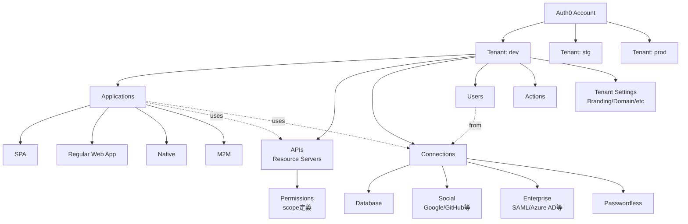

# 01. Auth0 の基礎

> Auth0 を初めて触る人が、用語と全体構造を 30 秒で把握するためのページ。

## 30 秒サマリ

- **Tenant** が最上位の分離単位。1 アカウントで複数作れる
- **Application**（クライアント）と **API**（保護対象）を分けて登録するのが Auth0 の流儀
- **Connection** がユーザーソース（DB / Social / Enterprise）
- **Rules / Hooks は 2026-11-18 で完全廃止**。新規実装は **Actions** を使う
- 無料枠は MAU 25,000 / Application 10 個 / API 10 個 / Action 5 個など。詳細は [07-cost-and-limits.md](./07-cost-and-limits.md)

## 全体像



## 詳細

### Tenant（テナント）

**なぜ重要か**: すべてのリソース（ユーザー / Application / API / 設定）は Tenant 単位で独立。環境分離（dev/stg/prod）の単位。

**知っておくこと**:
- 1 アカウントで複数 Tenant を作成可能（Free でも明示的な上限なし、公式ドキュメント明記なし）
- Tenant 名は **3〜63 文字の小文字英数字 + ハイフン**、グローバルにユニーク
- リージョン（US / EU / AU / JP）は Tenant 作成時に決定、後から変更不可

**落とし穴**:
- **MAU はテナントごとにカウントされ、サブスクリプション全体で合算**される。dev/stg/prod に同じユーザーが 1 回ずつログインすると 3 MAU 消費 → 分離はコスト不利
- **Production タグは Free 枠で 1 つだけ**。残りは低レートリミットの開発相当扱い

### Application（アプリケーション）

**なぜ重要か**: Auth0 に登録する「クライアント」の単位。種類によって発行できるトークン・許可されるフローが変わる。

**4 種類の使い分け**:

| 種類                          | 用途                                         | グラントタイプ                               |
| ----------------------------- | -------------------------------------------- | -------------------------------------------- |
| **Single Page Web App (SPA)** | React / Vue 等のブラウザ JS アプリ           | `authorization_code` + PKCE, `refresh_token` |
| **Regular Web App**           | Express / Next.js (SSR) 等のサーバ側ロジック | `authorization_code`, `refresh_token`        |
| **Native**                    | iOS / Android / デスクトップ                 | `authorization_code` + PKCE                  |
| **Machine to Machine (M2M)**  | バックエンドサービス / CLI / IoT             | `client_credentials`                         |

**落とし穴**:
- Free 枠で **10 個まで**。dev 用 / prod 用と分けると消費が早い
- 同じ Tenant 内で複数 Application を作っても MAU は重複カウントされない（ユーザー単位）

### API (Resource Server)

**なぜ重要か**: 保護対象の API を Auth0 に登録する。**audience** として参照され、Access Token の発行対象を決める。Permission（scope）の定義場所でもある。

**知っておくこと**:
- **Identifier**（例: `https://api.example.com`）は不変。URL である必要はないが慣習的に URL 形式
- `audience` パラメータでこの Identifier を指定して初めて **JWT 形式の Access Token** が発行される
  - audience 未指定だと `/userinfo` 用の **opaque token** になり、Workers で署名検証できない
- 「Add Permissions in the Access Token」を ON にすると Access Token に `permissions` claim が追加される（RBAC 利用時に重要）

### Connection（コネクション）

**なぜ重要か**: 「どこからユーザーを持ってくるか」を決める。Application は複数の Connection を有効化できる。

| 種類         | 例                            | Free 枠                        |
| ------------ | ----------------------------- | ------------------------------ |
| Database     | Auth0 標準 DB / Custom DB     | 標準 DB は標準提供             |
| Social       | Google / GitHub / Facebook 等 | **2 つまで**（後述の矛盾あり） |
| Enterprise   | SAML / Azure AD / ADFS / OIDC | 1 つまで                       |
| Passwordless | SMS / Email マジックリンク    | 標準提供                       |

**落とし穴**: Social Connection 数は pricing ページでは "Unlimited" と書かれているが、`entity-limit-policy` では「Free は最大 2」と明記されている。**安全側に倒して 2 つまでで設計**するのが無難。

### Actions（旧 Rules / Hooks の後継）

**なぜ重要か**: 認証フローに任意の Node.js コードを挟める。Custom Claim 追加・条件付きアクセス拒否・MFA 制御などに使う。

**知っておくこと**:
- **Rules / Hooks は 2026-11-18 で EOL**。すでに read-only。新規は Actions 一択
- 主要トリガー: `post-login` / `pre-user-registration` / `credentials-exchange`（M2M 時）
- 詳細は [05-authorization.md](./05-authorization.md)

## 具体例：最小構成のリソース定義（Terraform）

```hcl
# Tenant 内に「保護対象 API」と「SPA クライアント」を 1 つずつ
resource "auth0_resource_server" "api" {
  name        = "Demo API"
  identifier  = "https://api.demo.example.com"  # audience になる、不変
  signing_alg = "RS256"
  enforce_policies                                = true   # RBAC 有効化
  token_dialect                                   = "access_token_authz"  # permissions claim 付与
  skip_consent_for_verifiable_first_party_clients = true
}

resource "auth0_client" "spa" {
  name     = "Demo SPA"
  app_type = "spa"
  callbacks           = ["http://localhost:5173/callback"]
  allowed_logout_urls = ["http://localhost:5173"]
  allowed_origins     = ["http://localhost:5173"]
  web_origins         = ["http://localhost:5173"]
  grant_types         = ["authorization_code", "refresh_token"]
  jwt_configuration { alg = "RS256" }
  refresh_token {
    rotation_type   = "rotating"
    expiration_type = "expiring"
    token_lifetime  = 2592000
    leeway          = 0
  }
}
```

詳細は [02-terraform.md](./02-terraform.md)。

## 落とし穴サマリ

- **MAU はテナント別 + アカウント合算** → 環境分離はコスト不利
- **Social Connection 数の制限はドキュメント間で矛盾** → 2 つまでで設計
- **Rules / Hooks は EOL 直前** → Actions のみ使う
- **audience 未指定は opaque token** → 必ず API Identifier を指定
- **Application 10 個 / API 10 個の Free 枠** → dev/prod を別 Tenant に分けるか、命名で区別するか要検討

## 参考リンク

- [Auth0 Pricing](https://auth0.com/pricing)
- [Entity Limit Policy（プラン別実数値の公式リファレンス）](https://auth0.com/docs/troubleshoot/customer-support/operational-policies/entity-limit-policy)
- [Tenant Settings](https://auth0.com/docs/get-started/tenant-settings)
- [Applications 概念](https://auth0.com/docs/get-started/applications)
- [APIs (Resource Server) 概念](https://auth0.com/docs/get-started/apis)
- [Identity Providers / Connections](https://auth0.com/docs/authenticate/identity-providers)
- [Rules / Hooks EOL（2026-11-18）](https://auth0.com/blog/preparing-for-rules-and-hooks-end-of-life/)
- [MAU 計算方法](https://auth0.com/blog/auth0-monthly-active-user-mau-explained/)
