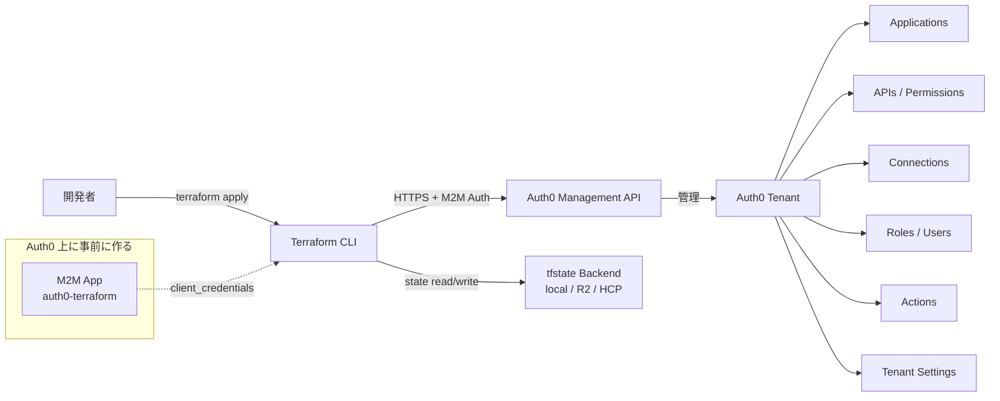

# 02. Terraform で Auth0 を管理する

> Auth0 のリソースを `auth0/auth0` Provider で IaC 化するための実用ガイド。

## 30 秒サマリ

- **Provider**: `auth0/auth0` v1.x（GA、Okta 公式メンテ）
- **認証**: Auth0 上に M2M Application を作り、Client ID/Secret を環境変数で渡す
- **tfstate**: 個人デモは local、チーム運用は **HCP Terraform 無料枠** 推奨。R2 は可能だがロック未確認
- **Secret は state に平文で入る** → state バックエンドの暗号化必須、Git に絶対上げない
- Auth0 CLI と併用（CLI は対話的な確認用、Terraform は宣言的管理）

## 全体像



## 詳細

### Provider のセットアップ

#### Step 1: Auth0 上に Terraform 用 M2M Application を作る

1. Auth0 Dashboard → Applications → Create Application
2. **Machine to Machine Application** を選択 → 名前は `auth0-terraform` 等
3. 「Authorize Machine to Machine Applications」で **Auth0 Management API** を選択
4. Permissions は **All を選択推奨**（Terraform は幅広いリソースを CRUD するため）
   - 最小権限運用したい場合は使うリソースの `read:* / create:* / update:* / delete:*` を個別付与
5. **Domain / Client ID / Client Secret** を控える

#### Step 2: Terraform 側の設定

```hcl
terraform {
  required_version = ">= 1.6"
  required_providers {
    auth0 = {
      source  = "auth0/auth0"
      version = "~> 1.50"
    }
  }
}

provider "auth0" {}  # 環境変数で渡す前提
```

#### Step 3: 環境変数で認証

```sh
export AUTH0_DOMAIN=your-tenant.us.auth0.com
export AUTH0_CLIENT_ID=...
export AUTH0_CLIENT_SECRET=...
# 任意: AUTH0_DEBUG=true で HTTP デバッグログ
```

| 環境変数                                  | 必須               | 用途                                     |
| ----------------------------------------- | ------------------ | ---------------------------------------- |
| `AUTH0_DOMAIN`                            | 必須               | テナントドメイン                         |
| `AUTH0_CLIENT_ID` / `AUTH0_CLIENT_SECRET` | 認証で必須         | M2M クライアント認証                     |
| `AUTH0_API_TOKEN`                         | 代替               | 既存の Management API トークンを直接使う |
| `AUTH0_AUDIENCE`                          | カスタムドメイン時 | Management API audience                  |
| `AUTH0_DEBUG`                             | 任意               | HTTP デバッグ                            |

### 主な管理可能リソース

| カテゴリ         | リソース                                                                               |
| ---------------- | -------------------------------------------------------------------------------------- |
| アプリケーション | `auth0_client`, `auth0_client_grant`, `auth0_client_credentials`                       |
| API              | `auth0_resource_server`, `auth0_resource_server_scopes`                                |
| コネクション     | `auth0_connection`, `auth0_connection_clients`                                         |
| Actions          | `auth0_action`, `auth0_trigger_action`, `auth0_trigger_actions`                        |
| ユーザ / ロール  | `auth0_user`, `auth0_role`, `auth0_user_role(s)`, `auth0_user_permissions`             |
| 組織             | `auth0_organization`, `auth0_organization_member`, `auth0_organization_connection`     |
| テナント         | `auth0_tenant`, `auth0_custom_domain`, `auth0_branding`, `auth0_pages`, `auth0_prompt` |
| その他           | `auth0_email_provider`, `auth0_email_template`, `auth0_log_stream`                     |

### tfstate バックエンドの選択肢

| 選択肢                              | メリット                                                 | デメリット                                                                              | 推奨            |
| ----------------------------------- | -------------------------------------------------------- | --------------------------------------------------------------------------------------- | --------------- |
| **local**                           | セットアップ不要、最速                                   | チーム共有不可、ロックなし、消失リスク                                                  | 個人デモ ◎      |
| **HCP Terraform 無料枠**            | UI で履歴・ロック・暗号化を完備、500 リソース/月まで無料 | HashiCorp アカウント必要                                                                | チーム運用 ◎    |
| **Cloudflare R2 (S3 backend 経由)** | プロジェクトが CF 一貫、egress 無料                      | DynamoDB 同等のロック未提供、`use_lockfile` (S3 Conditional Write) の R2 互換性は要検証 | デモ ○ / 本番 △ |
| **AWS S3 + DynamoDB**               | 実績豊富、ロック完備                                     | AWS アカウント必要                                                                      | AWS 併用なら ◎  |

#### R2 を S3 backend として使う場合の例

```hcl
terraform {
  backend "s3" {
    bucket = "my-tfstate"
    key    = "cloudflare-auth0-demo/terraform.tfstate"
    region = "auto"

    endpoints = {
      s3 = "https://<ACCOUNT_ID>.r2.cloudflarestorage.com"
    }

    skip_credentials_validation = true
    skip_metadata_api_check     = true
    skip_region_validation      = true
    skip_requesting_account_id  = true
    skip_s3_checksum            = true
    use_path_style              = true
  }
}
```

認証は R2 の bucket-scoped API トークン（Object R/W）を発行し、`AWS_ACCESS_KEY_ID` / `AWS_SECRET_ACCESS_KEY` で渡す。`access_key` / `secret_key` を backend block にハードコードしない。

> 注: Terraform 1.10+ の S3 Native Locking（`use_lockfile`）が R2 の Conditional Write に追随できるかは未検証。安全側に倒すなら HCP を選ぶ。

## 具体例：SPA + API + M2M の最小構成

```hcl
terraform {
  required_version = ">= 1.6"
  required_providers {
    auth0 = {
      source  = "auth0/auth0"
      version = "~> 1.50"
    }
  }
}

provider "auth0" {}

# 1. 保護対象 API
resource "auth0_resource_server" "demo_api" {
  name        = "Cloudflare Workers Demo API"
  identifier  = "https://api.demo.example.com"
  signing_alg = "RS256"

  enforce_policies                                = true
  token_dialect                                   = "access_token_authz"  # permissions claim 付与
  allow_offline_access                            = false
  skip_consent_for_verifiable_first_party_clients = true
}

resource "auth0_resource_server_scopes" "demo_api_scopes" {
  resource_server_identifier = auth0_resource_server.demo_api.identifier
  scopes {
    name        = "read:items"
    description = "Read items"
  }
  scopes {
    name        = "write:items"
    description = "Write items"
  }
}

# 2. SPA Application
resource "auth0_client" "spa" {
  name            = "Demo SPA"
  app_type        = "spa"
  oidc_conformant = true

  callbacks           = ["https://demo.example.com/callback", "http://localhost:5173/callback"]
  allowed_logout_urls = ["https://demo.example.com", "http://localhost:5173"]
  allowed_origins     = ["https://demo.example.com", "http://localhost:5173"]
  web_origins         = ["https://demo.example.com", "http://localhost:5173"]

  grant_types = ["authorization_code", "refresh_token"]

  jwt_configuration {
    alg = "RS256"
  }

  refresh_token {
    rotation_type   = "rotating"
    expiration_type = "expiring"
    token_lifetime  = 2592000
    leeway          = 0
  }
}

# 3. M2M Application（バックエンドや CI 用）
resource "auth0_client" "m2m" {
  name            = "Demo Backend (M2M)"
  app_type        = "non_interactive"
  oidc_conformant = true
  grant_types     = ["client_credentials"]
}

resource "auth0_client_grant" "m2m_to_api" {
  client_id  = auth0_client.m2m.id
  audience   = auth0_resource_server.demo_api.identifier
  scopes     = ["read:items", "write:items"]
  depends_on = [auth0_resource_server_scopes.demo_api_scopes]
}

resource "auth0_client_credentials" "m2m_creds" {
  client_id             = auth0_client.m2m.id
  authentication_method = "client_secret_post"
}

output "spa_client_id" {
  value = auth0_client.spa.client_id
}

output "api_audience" {
  value = auth0_resource_server.demo_api.identifier
}

output "m2m_client_id" {
  value = auth0_client.m2m.client_id
}

output "m2m_client_secret" {
  value     = auth0_client_credentials.m2m_creds.client_secret
  sensitive = true
}
```

## 既存リソースの import

1.x からは `terraform import` 必須（auto-import なし）。リソースごとに ID 形式が違う点に注意。

```sh
terraform import auth0_client.spa <client_id>
terraform import auth0_resource_server.demo_api <resource_server_id>
terraform import auth0_resource_server_scopes.demo_api_scopes <api_identifier>  # ← API identifier
terraform import auth0_client_credentials.m2m_creds <client_id>
terraform import auth0_action.foo <action_id>
```

既存テナントを一括で HCL 化したい場合は **Auth0 CLI の `auth0 terraform generate`** が便利（[06-dev-experience.md](./06-dev-experience.md) 参照）。

## 落とし穴

- **Secret は state に平文で入る**
  - `auth0_client.client_secret`, `auth0_client_credentials.client_secret`, `auth0_connection` の API キー、`auth0_email_provider` の認証情報など
  - 対策: state バックエンドの暗号化必須、`.tfstate` は絶対に Git に入れない、`sensitive = true` で output を保護
- **`identifier` は不変**
  - `auth0_resource_server.identifier` を変えると destroy → create になり、依存する client_grant も連鎖更新
- **削除順序**
  - `auth0_client_grant` は `auth0_resource_server_scopes` より後に作る必要があり、`depends_on` 明示が安全
- **Terraform 実行用 M2M を Terraform 配下に置く卵鶏問題**
  - 自分が apply に使っている M2M を Terraform で管理すると、誤って destroy/権限剥奪して apply 不可になる
  - 解決: Terraform 管理対象から外す、または別 Tenant の M2M で管理
- **Management API のレート制限**
  - 大量リソース apply 時に 429。`-parallelism` を下げる or 分割 apply
- **Drift**
  - Dashboard で手動変更すると drift する。`tenant` / `branding` のような単一リソースは特に競合しやすい
  - `auth0_user.roles` 等は片方に寄せる（`lifecycle { ignore_changes = [roles] }` を付ける運用もある）

## 参考リンク

- [Auth0 Provider - Terraform Registry](https://registry.terraform.io/providers/auth0/auth0/latest)
- [Provider docs (index)](https://registry.terraform.io/providers/auth0/auth0/latest/docs)
- [Quickstart guide](https://registry.terraform.io/providers/auth0/auth0/latest/docs/guides/quickstart)
- [GitHub: auth0/terraform-provider-auth0](https://github.com/auth0/terraform-provider-auth0)
- [Auth0 Docs - Terraform Provider](https://auth0.com/docs/deploy-monitor/auth0-terraform-provider)
- [Cloudflare: Remote R2 backend for Terraform](https://developers.cloudflare.com/terraform/advanced-topics/remote-backend/)
