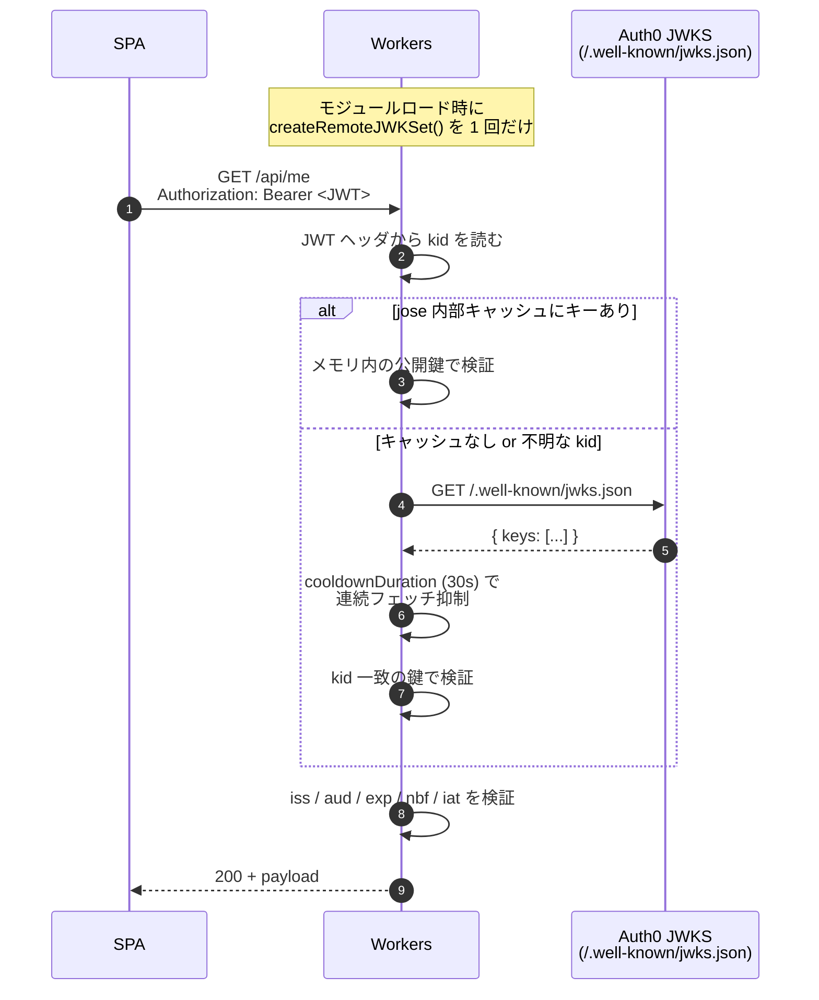

# 03. Cloudflare Workers での JWT 検証

> Workers が Auth0 発行の Access Token (JWT) を検証する実装パターン。

## 30 秒サマリ

- **ライブラリは `jose`**（panva/jose）が本命。Hono を採用なら組み込み `hono/jwk` も可
- **JWKS は `createRemoteJWKSet` の内部キャッシュ**（デフォルト 10 分）で十分。KV や Cache API への手動キャッシュは不要
- **`createRemoteJWKSet` はモジュールトップレベルで一度だけ生成**してハンドラで使い回す
- 必須検証: 署名 / `iss` / `aud` / `exp` / `nbf` / `iat` / `algorithms: ['RS256']`
- ハマりやすい順: ① **audience 未指定で opaque token**、② iss の末尾スラッシュ、③ `alg` allowlist 忘れ

## 全体像



## 詳細

### ライブラリ選定

| ライブラリ                     | 長所                                                                                                                                           | 短所                                                     | 推奨度             |
| ------------------------------ | ---------------------------------------------------------------------------------------------------------------------------------------------- | -------------------------------------------------------- | ------------------ |
| **`jose` (panva/jose)**        | Web Crypto API ベース、Workers ネイティブ動作。`createRemoteJWKSet` が JWKS フェッチ/キャッシュ/kid ローテーション内蔵。標準クレーム検証も揃う | バンドルやや大、`SubtleCrypto` 依存で Module Worker 必須 | ★★★★★              |
| **`hono/jwk`**                 | Hono 標準。`jwks_uri` と `alg` を渡すだけ。`cf` オプションで Workers Cache API も併用可                                                        | iss/aud は別途検証が必要（**署名検証のみ**）             | ★★★★ (Hono 採用時) |
| `@tsndr/cloudflare-worker-jwt` | バンドル極小、Workers 専用                                                                                                                     | JWKS 取り扱い未内蔵                                      | ★★                 |
| `jsonwebtoken` (Node)          | -                                                                                                                                              | **Node `crypto` 依存で Workers 非対応**                  | ×                  |

**推奨**: 自前ミドルウェアなら `jose`、Hono を使うなら `hono/jwk` + iss/aud 後段検証。

### JWKS の取り扱い

#### エンドポイント仕様
- URL: `https://{TENANT}.{REGION}.auth0.com/.well-known/jwks.json`
- 推奨アルゴリズム: **RS256**（HS256 は共有鍵運用で Workers 配布リスクあり）
- ローテーション時は新旧 `kid` が並走するため、`kid` ベースの解決が必須

#### キャッシュ戦略の比較

| 戦略                                              | レイテンシ         | コスト      | 用途                                      |
| ------------------------------------------------- | ------------------ | ----------- | ----------------------------------------- |
| **`jose` の内部キャッシュ（モジュールスコープ）** | 0ms (warm isolate) | 0           | **本命**。Workers の warm isolate と相性◎ |
| Cloudflare `fetch` キャッシュ (`cf.cacheTtl`)     | 数 ms (POP 内)     | 0           | isolate が頻繁に再生成されるケース        |
| Workers KV                                        | 数十 ms            | KV 読込課金 | JWKS には**過剰**（推奨せず）             |

#### `createRemoteJWKSet` のデフォルト

| オプション         | デフォルト         | 役割                                |
| ------------------ | ------------------ | ----------------------------------- |
| `cacheMaxAge`      | 600,000 ms (10 分) | 成功フェッチの最大キャッシュ時間    |
| `cooldownDuration` | 30,000 ms (30 秒)  | 未知 `kid` 流入時の連続フェッチ抑制 |
| `timeoutDuration`  | 5,000 ms (5 秒)    | HTTP リクエストタイムアウト         |
| `customFetch`      | -                  | `fetch` 差し替え                    |
| `jwksCache`        | -                  | 外部キャッシュの注入                |

### 検証項目チェックリスト

- [ ] **`algorithms: ['RS256']`** を明示（`alg: none` / HS256 confusion 対策）
- [ ] 署名検証（JWKS から kid 一致の公開鍵）
- [ ] `iss` = `https://{TENANT}.auth0.com/`（**末尾スラッシュ必須**）
- [ ] `aud` = API Identifier と完全一致
- [ ] `exp` / `nbf` / `iat`（jose が自動）
- [ ] `clockTolerance: '5 seconds'`（NTP ずれ吸収）
- [ ] `requiredClaims: ['sub', 'exp', 'iat']`
- [ ] スコープ / 権限（業務ロジックで）

## 具体例：Hono + jose の最小実装

### パターン A: `jose` を直接使う（推奨）

```typescript
// src/middleware/auth0.ts
import { createMiddleware } from 'hono/factory'
import { createRemoteJWKSet, jwtVerify, errors } from 'jose'
import type { JWTPayload } from 'jose'

type Bindings = {
  AUTH0_DOMAIN: string    // "your-tenant.us.auth0.com"
  AUTH0_AUDIENCE: string  // "https://api.example.com"
}

type Variables = {
  jwtPayload: JWTPayload & {
    sub: string
    scope?: string
    permissions?: string[]
  }
}

// モジュールスコープで isolate 間にキャッシュを共有
const jwksCache = new Map<string, ReturnType<typeof createRemoteJWKSet>>()

function getJWKS(domain: string) {
  let jwks = jwksCache.get(domain)
  if (!jwks) {
    jwks = createRemoteJWKSet(
      new URL(`https://${domain}/.well-known/jwks.json`),
      {
        cacheMaxAge: 10 * 60 * 1000,
        cooldownDuration: 30 * 1000,
        timeoutDuration: 5 * 1000,
      },
    )
    jwksCache.set(domain, jwks)
  }
  return jwks
}

export const auth0JwtMiddleware = createMiddleware<{
  Bindings: Bindings
  Variables: Variables
}>(async (c, next) => {
  const auth = c.req.header('Authorization')
  if (!auth?.match(/^Bearer\s+/i)) {
    return c.json({ error: 'missing_token' }, 401)
  }
  const token = auth.replace(/^Bearer\s+/i, '').trim()

  const jwks = getJWKS(c.env.AUTH0_DOMAIN)

  try {
    const { payload } = await jwtVerify(token, jwks, {
      issuer: `https://${c.env.AUTH0_DOMAIN}/`,  // 末尾 / 必須
      audience: c.env.AUTH0_AUDIENCE,
      algorithms: ['RS256'],
      clockTolerance: '5 seconds',
      requiredClaims: ['sub', 'exp', 'iat'],
    })
    c.set('jwtPayload', payload as Variables['jwtPayload'])
    await next()
  } catch (err) {
    if (err instanceof errors.JWTExpired) {
      return c.json({ error: 'token_expired' }, 401)
    }
    if (err instanceof errors.JWTClaimValidationFailed) {
      // 本番では詳細を返さずログのみ
      return c.json({ error: 'invalid_claim' }, 401)
    }
    if (err instanceof errors.JWSSignatureVerificationFailed) {
      return c.json({ error: 'invalid_signature' }, 401)
    }
    return c.json({ error: 'invalid_token' }, 401)
  }
})

// src/index.ts
import { Hono } from 'hono'
import { auth0JwtMiddleware } from './middleware/auth0'

const app = new Hono<{ Bindings: Bindings; Variables: Variables }>()

app.use('/api/*', auth0JwtMiddleware)

app.get('/api/me', (c) => {
  const payload = c.get('jwtPayload')
  return c.json({ sub: payload.sub, scope: payload.scope })
})

export default app
```

### パターン B: `hono/jwk`（署名検証のみ + iss/aud 後段）

```typescript
import { Hono } from 'hono'
import { jwk } from 'hono/jwk'

const app = new Hono<{ Bindings: Bindings }>()

app.use('/api/*', (c, next) =>
  jwk(
    {
      jwks_uri: `https://${c.env.AUTH0_DOMAIN}/.well-known/jwks.json`,
      alg: ['RS256'],
    },
    { cf: { cacheEverything: true, cacheTtl: 3600 } },
  )(c, next),
)

// hono/jwk は署名検証のみ → iss/aud を別途検証
app.use('/api/*', async (c, next) => {
  const p = c.get('jwtPayload')
  if (p.iss !== `https://${c.env.AUTH0_DOMAIN}/`) {
    return c.json({ error: 'iss' }, 401)
  }
  const aud = Array.isArray(p.aud) ? p.aud : [p.aud]
  if (!aud.includes(c.env.AUTH0_AUDIENCE)) {
    return c.json({ error: 'aud' }, 401)
  }
  await next()
})
```

## 落とし穴

1. **ID Token と Access Token の混同**
   - ID Token: `aud = Client ID`、SPA 側で検証
   - Access Token: `aud = API Identifier`、Workers 側で検証
   - Workers では **Access Token のみ**受け入れる
2. **audience 未指定で opaque token**
   - `/authorize` に `audience` を付けないと Access Token が opaque（JWT ではない）になる
   - Workers で署名検証ができず失敗。必ず API Identifier を `audience` に指定
3. **`iss` の末尾スラッシュ**
   - Auth0 は `https://tenant.auth0.com/`（末尾 `/` 付き）。`jose` は完全一致なので忘れると 401
4. **`createRemoteJWKSet` をリクエスト毎に生成**
   - 内部キャッシュがリセットされ毎回 HTTP フェッチ → CPU 時間と egress を消費。モジュールスコープで 1 度だけ
5. **`algorithms` allowlist 忘れ**
   - 省略すると `HS256` confusion 攻撃を受け得る。必ず `['RS256']` を明示
6. **過剰な `cacheMaxAge`**
   - キーローテーション直後に古い `kid` を引きずると 401 多発。デフォルト（10 分 / 30 秒）で十分
7. **Clock skew**
   - `iat` がワーカー時計よりわずかに未来になることあり。`clockTolerance: '5 seconds'`
8. **`Authorization` ヘッダの大文字小文字**
   - `Bearer ` でも `bearer ` でも受けるよう `/^Bearer\s+/i` でマッチ
9. **エラーレスポンスから情報漏えい**
   - `JWTClaimValidationFailed.claim` を返すと攻撃者にヒント。本番は `401` のみ、詳細はサーバログ
10. **`hono/jwk` 使用時の iss/aud 未検証**
    - 署名検証しか行わないため、後段で iss/aud を必ず検証

## 参考リンク

- [Auth0: Validate Access Tokens](https://auth0.com/docs/secure/tokens/access-tokens/validate-access-tokens)
- [Auth0: Validate JSON Web Tokens](https://auth0.com/docs/secure/tokens/json-web-tokens/validate-json-web-tokens)
- [Auth0: JWT Claims](https://auth0.com/docs/secure/tokens/json-web-tokens/json-web-token-claims)
- [panva/jose: README](https://github.com/panva/jose)
- [panva/jose: createRemoteJWKSet](https://github.com/panva/jose/blob/main/docs/jwks/remote/functions/createRemoteJWKSet.md)
- [panva/jose: jwtVerify](https://github.com/panva/jose/blob/main/docs/jwt/verify/functions/jwtVerify.md)
- [Hono: JWK Auth Middleware](https://hono.dev/docs/middleware/builtin/jwk)
- [Cloudflare: Workers Cache API](https://developers.cloudflare.com/workers/runtime-apis/cache/)
