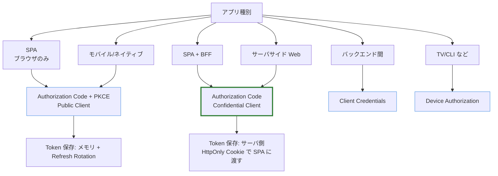
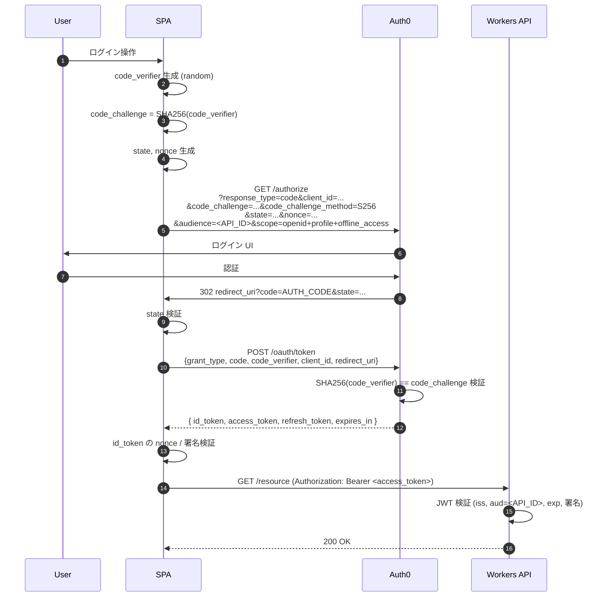

# 04. 認証フローの選定

> SPA + Workers 構成での OAuth2 / OIDC フローの選び方と、Token の扱い方。

## 30 秒サマリ

- **フローは Authorization Code + PKCE** 一択（Implicit / ROPC は非推奨で確定）
- **構成は (A) SPA 直接 / (B) BFF** の 2 択。本番推奨は **(B) BFF**（IETF BCP 準拠）、デモなら (A) でも可
- **Token 保存場所のベスト**: BFF 経由の HttpOnly Cookie。次点: メモリ + Refresh Token Rotation
- **localStorage は禁止**（XSS 1 発で全権限漏洩）
- **audience を指定しないと opaque token** になる Auth0 仕様に注意

## 全体像



## 詳細

### フロー選定マトリクス

| アプリ種別            | 推奨フロー                                                         | 理由                                           |
| --------------------- | ------------------------------------------------------------------ | ---------------------------------------------- |
| SPA（ブラウザのみ）   | Authorization Code + PKCE                                          | Implicit は IETF BCP で非推奨確定              |
| **SPA + BFF（推奨）** | Authorization Code（Confidential Client） + BFF で HttpOnly Cookie | IETF BCP「業務・機密データを扱うなら強く推奨」 |
| サーバサイド Web      | Authorization Code                                                 | client_secret を安全に保持できる               |
| ネイティブ            | Authorization Code + PKCE                                          | 機密保持不可の public client                   |
| M2M                   | Client Credentials                                                 | ユーザー文脈不要                               |
| TV/CLI                | Device Authorization                                               | キーボード入力困難な環境                       |
| ~~Implicit~~          | —                                                                  | **MUST NOT be used (IETF BCP)**                |
| ~~ROPC~~              | —                                                                  | OAuth2.1 ドラフトで削除予定                    |

### Authorization Code + PKCE シーケンス



各パラメータの役割:
- **code_verifier / code_challenge**: 認可コード横取り防止（PKCE）
- **state**: CSRF 対策
- **nonce**: ID Token の replay 防止（OIDC）
- **audience**: Auth0 固有。**指定しないと API 用 JWT が発行されない**

### SPA + Workers での 2 つの選択肢

#### (A) SPA 直接パターン（Public Client）

```
[Browser SPA] --PKCE--> [Auth0]
     |  access_token (in memory)
     v
[Workers API]  -- JWT 検証 --
```

**メリット**:
- 実装シンプル（Auth0 SPA SDK + Workers の JWT ミドルウェアのみ）
- Workers がステートレス
- ログアウト / token rotation を SDK 任せ

**デメリット**:
- access/refresh token がブラウザ JS から到達可能 → **XSS 1 発で全権限漏洩**
- 第三者 Cookie/ITP 制限で silent auth が不安定 → Refresh Token Rotation 必須
- IETF BCP では「小規模・低リスク向け」位置付け

#### (B) BFF パターン（推奨）

```
[Browser SPA] --HttpOnly Cookie--> [Workers BFF]
                                         | client_secret 保持
                                         v
                                     [Auth0]
                                         |
[Workers BFF] --access_token (server)--> [Resource API]
```

Workers が `/login`, `/callback`, `/logout`, `/api/*` を提供。トークンは **暗号化セッション Cookie / Workers KV / Durable Objects** に保持し、ブラウザには **HttpOnly + Secure + SameSite=Lax** のセッション Cookie のみ渡す。

**メリット**:
- access/refresh token がブラウザに一切露出しない → XSS でトークン漏洩しない
- Auth0 を Confidential Client として扱える（client_secret + PKCE の二重防御）
- IETF BCP の現行推奨アーキテクチャ
- Workers がエッジで動くため BFF のレイテンシペナルティが小さい

**デメリット**:
- セッションストア（暗号化 Cookie / KV / DO）の設計が必要
- API が Workers と同一オリジン（または同一 origin プロキシ）である必要
- ログ/監視で Workers 側のセッション管理が一系統増える

### 推奨

**本番は (B) BFF**、**デモ/学習は (A)** で読者の負荷を下げるという二段構え。本リポジトリでは両方扱う。

Workers BFF の実装ポイント:
- セッション: 暗号化 JWE Cookie（ステートレス維持）or Workers KV（小規模なら十分）
- トークン保存: セッション内に encrypted access_token + refresh_token
- Refresh: API リクエスト時に Workers 側で expired を検知して自動 refresh
- CSRF: `SameSite=Lax` + state、書き込み API は Origin ヘッダ検証 or CSRF token

### Token 保存場所の比較

| 方式                            | セキュリティ                                         | 実装難度 | 推奨度                           |
| ------------------------------- | ---------------------------------------------------- | -------- | -------------------------------- |
| **HttpOnly Cookie (BFF)**       | ◎ JS から読めず XSS で漏洩しない                     | 中       | ★★★                              |
| メモリ + Refresh Token Rotation | ○ リロードで揮発、XSS 中は読まれ得るが盗難の影響限定 | 低〜中   | ★★                               |
| sessionStorage                  | △ XSS で読み放題、同タブのみ                         | 低       | ★                                |
| **localStorage**                | × **XSS で全トークン漏洩**                           | 低       | **禁止**（IETF BCP discouraged） |
| IndexedDB                       | × localStorage と同等                                | 中       | 非推奨                           |
| Service Worker                  | ○ JS から隔離可能だが仕様化途上                      | 高       | △                                |

### Refresh Token Rotation

**動作**: refresh_token を `/oauth/token` に提示するたびに、新しい access_token と **新しい refresh_token がペアで返る**。古い refresh_token は即無効化。

**Automatic Reuse Detection**:
- 使用済み refresh_token が再提示された瞬間、Auth0 が **同一トークンファミリ（祖先共有の全 refresh_token）を一括無効化**
- 攻撃者が先に使っても正規クライアントが先に使っても、いずれにせよ「2 度目の使用」が攻撃の証拠
- 監査ログに `ferrt` イベントが記録される

**有効化**:
1. Dashboard で Application の「Refresh Token Rotation」を ON
2. `Refresh Token Expiration` を Inactivity / Absolute で設定
3. SDK 側は `offline_access` スコープを要求

**SPA で実質必須**: ブラウザの ITP（Safari/Brave）が Auth0 セッション Cookie をブロックして silent auth が動かなくなるため、Refresh Token Rotation で代替する。

## 落とし穴

1. **ID Token を API 認可に使う**
   - ID Token: 「誰がログインしたか」、`aud = Client ID`、SPA 側で検証
   - Access Token: 「何ができるか」、`aud = API Identifier`、API 側で検証
   - Workers で `id_token` を Bearer として受け入れるのは設計ミス
2. **audience 未指定で opaque token**
   - `/authorize` に `audience` を付けない / `audience=https://{tenant}/userinfo` だと **opaque token** が返る
   - JWT として検証できない。**Custom API を登録して Identifier を `audience` に指定**する
3. **「PKCE をやったから state は不要」誤解**
   - PKCE: 認可コード横取り防御
   - state: CSRF 防御
   - **目的が違う**ので両方必要。OIDC では nonce も
4. **localStorage に refresh_token を入れる**
   - XSS で永続的な認可漏洩。Rotation 入れても最新トークン抜かれた瞬間に攻撃者が先に使えば乗っ取り完了
5. **JWT 検証で `aud` / `iss` チェック省略**
   - 署名検証だけでなく `aud == 自分の API ID`、`iss == https://{tenant}.auth0.com/`、`exp` を必須化
6. **Refresh Token Rotation 未設定で SPA に refresh_token を渡す**
   - 長期 refresh_token を SPA に渡すのは最悪パターン。Rotation + Absolute Lifetime をセットで
7. **`SameSite=None` Cookie + CSRF 対策なし（BFF）**
   - クロスサイト Cookie では SameSite で CSRF を防げない。別途 CSRF token / Origin ヘッダ検証
8. **silent auth (`prompt=none`) が ITP で動かない**
   - `checkSession()` 系は Safari/Brave で機能しない → Refresh Token Rotation が事実上の代替

## 参考リンク

- [Auth0: Authentication and Authorization Flows](https://auth0.com/docs/get-started/authentication-and-authorization-flow)
- [Auth0: Authorization Code Flow with PKCE](https://auth0.com/docs/get-started/authentication-and-authorization-flow/authorization-code-flow-with-pkce)
- [Auth0: Refresh Token Rotation](https://auth0.com/docs/secure/tokens/refresh-tokens/refresh-token-rotation)
- [Auth0: Access Tokens](https://auth0.com/docs/secure/tokens/access-tokens)
- [Auth0: State Parameters](https://auth0.com/docs/secure/attack-protection/state-parameters)
- [IETF: OAuth 2.0 for Browser-Based Apps (BCP)](https://datatracker.ietf.org/doc/html/draft-ietf-oauth-browser-based-apps)
