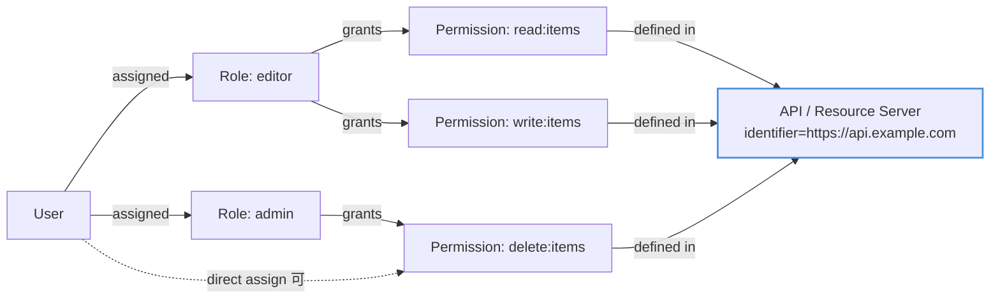

# 05. 認可（RBAC / Actions / Custom Claims）

> 「誰が何をできるか」をどう設計し、Workers 側でどう検証するか。

## 30 秒サマリ

- **Auth0 標準の Core RBAC** を使う：API に Permission を定義 → Role に紐付け → User に Role を割当
- **API 設定で 2 つの ON が必要**：「Enable RBAC」と「Add Permissions in the Access Token」
- Token に追加情報を入れたい時は **Actions**（`post-login` トリガー）で Custom Claim を埋め込む
- **`permissions` claim は Auth0 独自・配列**、**`scope` は OAuth2 標準・空白区切り文字列**。混同注意
- **Custom Claim の名前空間は `https://` で始まる URI 必須**

## 全体像



## 詳細

### Core RBAC のモデル

| 概念                      | 説明                                           | 設定場所                    |
| ------------------------- | ---------------------------------------------- | --------------------------- |
| **Permission**            | 「何ができるか」の最小単位（例: `read:items`） | API ごとに定義              |
| **Role**                  | Permission の束（例: `editor`）                | 単独のリソース              |
| **User**                  | 認証されるユーザー                             | Connection から取り込まれる |
| **API (Resource Server)** | 保護対象。Permission の定義場所                | `audience` として参照される |

**関係**:
- User → 複数 Role 割当（権限は和集合）
- Role → 複数 API の Permission を束ねられる
- User → 直接 Permission 付与も可能（Role を経由しなくてもよい）

### RBAC の設定手順

#### 1. API に Permissions を定義

Dashboard: Applications → APIs → 対象 API → **Permissions** タブ

慣習: `動詞:リソース` 形式（`read:messages`, `write:messages`）

#### 2. Role を作って Permission を付与

Dashboard: User Management → Roles → Create Role → **Permissions** タブから付与

#### 3. User に Role を割り当て

Dashboard: User Management → Users → 対象ユーザー → **Roles** タブ → Assign Roles

#### 4. API 設定で RBAC を有効化（**必須**）

Dashboard: Applications → APIs → 対象 API → Settings → **RBAC Settings**

- **Enable RBAC**: ON → `scope` claim が「リクエスト scope ∩ ユーザー付与済み permissions」にフィルタされる
- **Add Permissions in the Access Token**: ON → Access Token に `permissions` claim（配列）が追加される

Terraform で同等設定:

```hcl
resource "auth0_resource_server" "api" {
  identifier       = "https://api.example.com"
  enforce_policies = true                       # Enable RBAC
  token_dialect    = "access_token_authz"       # Add Permissions in Access Token
}
```

#### Access Token に追加される claim

```json
{
  "iss": "https://your-tenant.auth0.com/",
  "sub": "auth0|...",
  "aud": "https://api.example.com",
  "scope": "read:messages",
  "permissions": ["read:messages", "write:messages"]
}
```

### Actions（Rules / Hooks の後継）

**できること**:
- Node.js 関数を認証フローに挟む
- Custom Claim 追加、アクセス拒否、MFA 制御、ユーザーメタデータ更新、外部 API 呼び出し
- ほぼすべての公開 npm パッケージを利用可能

**主要トリガー**:

| トリガー                        | タイミング                                   | 用途                            |
| ------------------------------- | -------------------------------------------- | ------------------------------- |
| `post-login`                    | ログイン成功後（Refresh Token 交換時も実行） | Custom Claim 追加、条件付き拒否 |
| `pre-user-registration`         | DB / Passwordless 登録前                     | 入力検証                        |
| `post-user-registration`        | 登録完了後                                   | 通知 / 同期                     |
| `credentials-exchange`          | M2M（Client Credentials Flow）時             | M2M トークンへの Custom Claim   |
| `password-reset-post-challenge` | パスワードリセット後                         | 監査ログ                        |
| `send-phone-message`            | MFA 用 SMS / 音声送信                        | カスタム送信                    |

### Custom Claim の例（post-login）

```javascript
// post-login Action
exports.onExecutePostLogin = async (event, api) => {
  const namespace = 'https://my-app.example.com'  // 必ず URI 形式

  if (event.authorization) {
    // ID Token に Role（UI 表示用）
    api.idToken.setCustomClaim(
      `${namespace}/roles`,
      event.authorization.roles,
    )

    // Access Token に Role（Workers 側で参照）
    api.accessToken.setCustomClaim(
      `${namespace}/roles`,
      event.authorization.roles,
    )
  }

  // 任意属性（例: テナント ID）
  api.accessToken.setCustomClaim(
    `${namespace}/tenant_id`,
    event.user.app_metadata?.tenant_id ?? null,
  )
}
```

注意:
- 名前空間は **`http://` または `https://` で始まる URI** 必須
- **`auth0.com` / `webtask.io` ドメインは使用不可**（予約済み）
- `permissions` claim は「Add Permissions in the Access Token」ON で自動付与されるため、Action で重複追加不要

## Workers 側の権限チェック実装

```typescript
import { jwtVerify, createRemoteJWKSet } from 'jose'

const AUTH0_DOMAIN = 'your-tenant.auth0.com'
const AUDIENCE = 'https://api.example.com'
const JWKS = createRemoteJWKSet(new URL(`https://${AUTH0_DOMAIN}/.well-known/jwks.json`))

type Auth0AccessToken = {
  sub: string
  scope?: string                 // 空白区切り
  permissions?: string[]         // 「Add Permissions」ON 時
  'https://my-app.example.com/roles'?: string[]
  'https://my-app.example.com/tenant_id'?: string
}

async function verifyToken(authHeader: string | null) {
  if (!authHeader?.match(/^Bearer\s+/i)) {
    throw new Response('Unauthorized', { status: 401 })
  }
  const token = authHeader.replace(/^Bearer\s+/i, '')
  const { payload } = await jwtVerify(token, JWKS, {
    issuer: `https://${AUTH0_DOMAIN}/`,
    audience: AUDIENCE,
    algorithms: ['RS256'],
  })
  return payload as Auth0AccessToken
}

function hasPermission(payload: Auth0AccessToken, required: string): boolean {
  // permissions を優先（RBAC + Add Permissions ON）
  if (payload.permissions?.includes(required)) return true
  // フォールバック: scope（空白区切り）
  return payload.scope?.split(' ').includes(required) ?? false
}

export default {
  async fetch(req: Request) {
    const payload = await verifyToken(req.headers.get('Authorization'))

    if (!hasPermission(payload, 'read:items')) {
      return new Response('Forbidden', { status: 403 })
    }

    // Role ベースの分岐（Custom Claim 経由）
    const roles = payload['https://my-app.example.com/roles'] ?? []
    if (req.method === 'DELETE' && !roles.includes('admin')) {
      return new Response('Forbidden', { status: 403 })
    }

    return new Response('OK')
  },
}
```

**判断指針**:
- API 単位の細粒度認可 → `permissions` claim
- 画面側で見せる役割表示 / 粗い分岐 → Custom Claim の `roles`
- ユーザートークンと M2M トークンを同一 API で受ける → `scope` 側を統一的に見る

## permissions vs scope

|             | `permissions`                               | `scope`                                            |
| ----------- | ------------------------------------------- | -------------------------------------------------- |
| 用途        | ユーザーが**実際に持っている**権限の列挙    | クライアントが**要求した**権限のうち付与されたもの |
| 形式        | 配列 `["read:x", "write:x"]`                | 空白区切り文字列 `"openid read:x write:x"`         |
| 設定        | API の「Add Permissions in Access Token」ON | OIDC 標準 / `scope` パラメータ                     |
| RBAC ON 時  | 付与済み permission 全件                    | リクエスト scope ∩ ユーザー permission             |
| RBAC OFF 時 | 入らない                                    | リクエスト scope そのまま                          |
| 標準性      | Auth0 独自 claim                            | OAuth 2.0 / OIDC 標準                              |

## M2M Application の scope 管理

- Dashboard: Applications → APIs → 対象 API → **Machine to Machine Applications** タブ
- M2M アプリごとに付与する scope（= API の permissions）をチェック
- M2M トークンには「ユーザー」がいないため **アプリに直接 scope を付与**
- Custom Claim を追加するなら `credentials-exchange` トリガーの Action

> 補足: M2M トークンで `permissions` claim が付与されるかは公式の明示記述なし（要実機検証）。確実なのは `scope` 側に出ること。

## Organization と RBAC（B2B）

- Organizations は B2B 顧客向けのテナント内マルチテナント機能
- ユーザーは複数 Organization に所属可能
- Organization 単位で Role を割り当てられる（**Organization-Specific Roles**）
- ログイン時に Organization を指定すると、Access Token / ID Token に `org_id` claim 追加

B2B 設計指針:
- テナント分離 → Organization
- 「テナント内での権限」→ Organization-Specific Roles
- Workers 側は `org_id` で識別、`permissions` で権限チェック

詳細は [Auth0: Using Tokens with Organizations](https://auth0.com/docs/manage-users/organizations/using-tokens) を参照。

## 落とし穴

- **標準 OIDC クレーム（`email`, `name`, `phone_number`）は Custom Claim で上書き不可**。別 claim にする
- **名前空間の URI 制限**: `auth0.com` / `webtask.io` を含む URI は無視される
- **`permissions` と `scope` の混同**: RBAC ON でも「Add Permissions in the Access Token」を ON にしないと `permissions` claim は付かない
- **型違い**: `permissions` は配列、`scope` は空白区切り文字列
- **Access Token の payload 上限は 100KB**: Role/Permission 大量だと超過の可能性
- **Rules / Hooks は 2026-11-18 EOL**: 新規実装は Actions のみ
- **post-login Action は Refresh Token 交換時も再実行される**: 重い処理（外部 API 呼び出し等）はレイテンシに直結
- **M2M トークンには `event.authorization` が存在しない**: post-login のロジックを `credentials-exchange` に流用しない
- **JWT 検証を忘れない**: `permissions` claim を信用する前に署名/iss/aud/exp を必ず検証

## 参考リンク

- [Auth0: RBAC 概念](https://auth0.com/docs/manage-users/access-control/rbac)
- [Auth0: Configure Core RBAC](https://auth0.com/docs/manage-users/access-control/configure-core-rbac)
- [Auth0: Enable RBAC for APIs](https://auth0.com/docs/get-started/apis/enable-role-based-access-control-for-apis)
- [Auth0: Actions](https://auth0.com/docs/customize/actions)
- [Auth0: post-login Trigger](https://auth0.com/docs/customize/actions/triggers/post-login)
- [Auth0: Create Custom Claims](https://auth0.com/docs/secure/tokens/json-web-tokens/create-custom-claims)
- [Auth0: API Scopes](https://auth0.com/docs/get-started/apis/scopes/api-scopes)
- [Auth0: Organizations](https://auth0.com/docs/manage-users/organizations)
- [Auth0: Using Tokens with Organizations](https://auth0.com/docs/manage-users/organizations/using-tokens)
