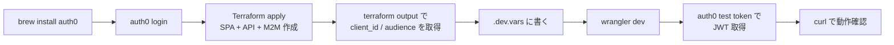
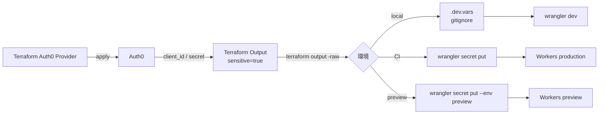

# 06. 開発体験（DX）

> CLI の使い分け、ローカル開発、テスト戦略、Secret 管理。日々の開発フロー全般。

## 30 秒サマリ

- **CLI 3 種の使い分け**: Auth0 CLI（対話確認・トークン取得・**全員必携**）/ Deploy CLI（YAML 一括同期）/ Terraform Provider（IaC・推奨）
- **本リポジトリは Terraform Provider を採用**。Deploy CLI は使わない
- **ローカルは `wrangler dev` + `.dev.vars`**。Callback URL に `http://localhost:8787/callback` 等を Allowed に登録
- **テストは Vitest + `@cloudflare/vitest-pool-workers`**。JWKS はモックして RSA 鍵を自前生成
- **Secret は `wrangler secret put`**（即デプロイ）。本番運用は `wrangler versions secret put` + gradual rollout

## 全体像

```mermaid
graph TB
    Dev[開発者]

    Dev -->|宣言的管理| TF[Terraform]
    Dev -->|対話確認| A0CLI[Auth0 CLI]
    Dev -->|起動| WR[wrangler dev]
    Dev -->|テスト| VT[Vitest]

    TF -->|apply| Auth0[Auth0 Tenant]
    A0CLI -->|test token / logs tail| Auth0
    WR -->|localhost:8787| LocalAPI[Worker ローカル]
    LocalAPI -.|.dev.vars|.-> Env[環境変数]

    VT -->|miniflare| MockJWKS[mock JWKS]
    VT -->|jose.generateKeyPair| TestKey[test RSA key]

    TF -->|output| Sec[client_secret 等]
    Sec -->|terraform output -raw + pipe| WSec[wrangler secret put]
    WSec -->|deploy| Prod[Workers 本番]

    style TF stroke:#2e7d32,stroke-width:2px
    style A0CLI stroke:#2e7d32,stroke-width:2px
```

## 詳細

### CLI 選定

| ツール                                          | 用途                                     | 主な機能                                                                                                                                                                                                                            | 採用判断                           |
| ----------------------------------------------- | ---------------------------------------- | ----------------------------------------------------------------------------------------------------------------------------------------------------------------------------------------------------------------------------------- | ---------------------------------- |
| **Auth0 CLI** (`auth0/auth0-cli`, Go)           | 対話的な動作確認・デバッグ・トークン取得 | `auth0 login`, `auth0 test login`（Universal Login をブラウザで起動）, `auth0 test token`（M2M なら client_credentials）, `auth0 logs tail`, `auth0 apps/apis/users/tenants`, **`auth0 terraform generate`（既存テナント→HCL 化）** | **全員必携**                       |
| **Deploy CLI** (`auth0/auth0-deploy-cli`, Node) | テナント設定の YAML/JSON export/import   | `a0deploy export/import`, keyword replacement で環境差分注入                                                                                                                                                                        | **採用しない**（Terraform で代替） |
| **Terraform Provider**                          | 宣言的 IaC                               | HCL でリソース定義                                                                                                                                                                                                                  | **本リポジトリで採用**             |

Auth0 公式は「既に Terraform を使っているなら Terraform Provider、避けたいなら Deploy CLI」と案内。Cloudflare 側も `cloudflare/cloudflare` Provider と組み合わせると一貫性が高い。

### ローカル開発セットアップ



#### Step by Step

1. **Auth0 CLI インストール**
   ```sh
   brew tap auth0/auth0-cli && brew install auth0
   ```
2. **Auth0 へ認証**
   ```sh
   auth0 login              # 個人開発機は device flow
   # CI は: auth0 login --client-id ... --client-secret ...
   ```
3. **dev Tenant に SPA / Regular Web App を Terraform で作成**（[02-terraform.md](./02-terraform.md) 参照）
4. **Callback / Allowed Origins に localhost を登録**
   - Callbacks: `http://localhost:8787/callback`（BFF）または `http://localhost:5173/callback`（SPA 直接）
   - Allowed Web Origins / Allowed Logout URLs: 同様
5. **Worker 側 Secret を `.dev.vars`**
   ```
   AUTH0_DOMAIN="dev-xxxxx.us.auth0.com"
   AUTH0_AUDIENCE="https://api.example.com"
   AUTH0_CLIENT_ID="..."
   AUTH0_CLIENT_SECRET="..."
   ```
   - `.dev.vars` は `.gitignore` 必須
   - `.env` と同時利用は非推奨
6. **起動**
   ```sh
   wrangler dev               # default localhost:8787
   wrangler dev --local       # リモートバインディング無効
   wrangler dev --remote      # リモート資源接続
   ```
7. **動作確認**
   ```sh
   # M2M トークンで API テスト
   TOKEN=$(auth0 test token <m2m-client-id> -a https://api.example.com -s read:items --json | jq -r .access_token)
   curl -H "Authorization: Bearer $TOKEN" http://localhost:8787/api/me

   # ブラウザフローは
   auth0 test login           # Universal Login をローカルで起動
   ```

### 複数開発者での運用パターン

| パターン                                        | 構成                                                                        | 利点                                | 欠点                                       |
| ----------------------------------------------- | --------------------------------------------------------------------------- | ----------------------------------- | ------------------------------------------ |
| **A: 共有 dev Tenant + 個人 App**               | 1 つの `your-app-dev` テナントを全員で共有、各自が SPA Application を作成   | Connection / DB が共有でテスト効率◎ | Tenant 設定（Action 等）変更は全員に影響   |
| **B: 個人 Tenant + 共通 Terraform**             | 各自が無料 Tenant 作成、共通 HCL を apply                                   | 完全独立、設定実験が安全            | 初期セットアップが重い                     |
| **C（推奨）: dev / stg / prod 分離 + dev 共有** | 単一リポジトリ + ブランチ別 var.tfvars、CI が dev → stg → prod の単方向昇格 | 環境分離 + 効率の両立               | Free 枠の Production タグは 1 つだけの制約 |

### テスト戦略

| レイヤー               | 戦略                                                                                                                                                                                                                                    |
| ---------------------- | --------------------------------------------------------------------------------------------------------------------------------------------------------------------------------------------------------------------------------------- |
| **ユニット**           | `@cloudflare/vitest-pool-workers` を使用。`vitest.config.ts` の `miniflare.bindings` でテスト用 env を注入。JWT 検証は `jose.generateKeyPair` で生成した RSA 鍵で JWT を発行し、JWKS URL をローカル mock サーバに差し替える             |
| **統合 (Worker内)**    | `cloudflare:workers` から `exports` を import → `exports.default.fetch(new Request(...), env, ctx)` で同一コンテキストで呼ぶ。`miniflare.serviceBindings` で JWKS をモック Worker に向ける                                              |
| **統合 (外部API混在)** | 別 Worker (auxiliary worker) を `SELF` 相当の serviceBindings に登録し、Auth0 JWKS をモック                                                                                                                                             |
| **E2E**                | `wrangler deploy --env preview` でプレビュー公開 → Auth0 の "Test Application" の Callback URL にプレビュー URL を登録 → Playwright / chrome-devtools MCP で Universal Login を実走行。M2M API テストは CI で `client_credentials` curl |

#### JWT 検証ユニットテストの考え方

```typescript
// jose.generateKeyPair で公開鍵/秘密鍵を生成
// → 秘密鍵で JWT 署名
// → 公開鍵を /.well-known/jwks.json のモックレスポンスとして返す
// → 本番コードの createRemoteJWKSet がモックを引いて検証成功
import { generateKeyPair, SignJWT, exportJWK } from 'jose'

const { publicKey, privateKey } = await generateKeyPair('RS256')
const jwk = await exportJWK(publicKey)
jwk.kid = 'test-kid'
jwk.use = 'sig'
jwk.alg = 'RS256'

const token = await new SignJWT({ sub: 'test-user', permissions: ['read:items'] })
  .setProtectedHeader({ alg: 'RS256', kid: 'test-kid' })
  .setIssuer('https://test-tenant.auth0.com/')
  .setAudience('https://api.example.com')
  .setExpirationTime('1h')
  .sign(privateKey)

// fetch をモックして /.well-known/jwks.json に { keys: [jwk] } を返す
```

### Secret 管理



**運用ルール**:
- `wrangler secret put <KEY>` は実行時に **新しい Worker バージョンを作成して即時デプロイ** → 段階デプロイ時は `wrangler versions secret put` + gradual rollout を使う
- 一括投入: `wrangler deploy --secrets-file .env.production`
- 環境別ファイル: `.dev.vars.<env>` があれば `.dev.vars` は読まれない
- `.dev.vars*` / `.env*` は必ず `.gitignore`
- Terraform output には `sensitive = true`。CI からは
  ```sh
  echo "$(terraform output -raw m2m_client_secret)" | wrangler secret put AUTH0_CLIENT_SECRET
  ```

## 落とし穴

- **Wrangler の `.dev.vars` と `.env` 同時利用は非推奨** → 挙動が読みにくい
- **`wrangler secret put` は即デプロイ** → 本番は `wrangler versions secret put` + gradual rollout
- **Workerd は `TZ=UTC` 固定** → `new Date().getHours()` がローカル時刻と一致しない
- **Deploy CLI は破壊的** → `AUTH0_ALLOW_DELETE` 既定挙動の理解なしで prod に向けると設定が消える（本リポジトリでは採用しないが要注意）
- **Deploy CLI の keyword replacement**: `@@` は JSON 文字列化（quote 付き）、`##` はリテラル。配列を `##` で展開すると JSON 不正に
- **Auth0 Management API のレート制限** → CI で頻繁に Terraform/CLI を流すとサブスクリプション上限に抵触
- **Callback URL は完全一致**: `http://localhost:8787/callback` と `http://localhost:8787/callback/` は別物
- **共有 Tenant の Action / Rule 改変は全員に影響** → 本リポジトリでは Terraform でバージョン管理して安全に
- **`auth0 test token` は app type で grant が変わる**: M2M App では `client_credentials`、Regular Web / SPA では `authorization_code`。目的に応じた client_id を渡す
- **Durable Objects / Workflows は `wrangler dev --remote` でも直接リモート接続不可** → セッションを DO に持つ設計はローカルテストの構成に注意

## 参考リンク

- [auth0/auth0-cli (GitHub)](https://github.com/auth0/auth0-cli)
- [Auth0 CLI Command Reference](https://auth0.github.io/auth0-cli/)
- [auth0 test login](https://auth0.github.io/auth0-cli/auth0_test_login.html) / [auth0 test token](https://auth0.github.io/auth0-cli/auth0_test_token.html)
- [auth0/auth0-deploy-cli (GitHub)](https://github.com/auth0/auth0-deploy-cli)
- [Deploy CLI vs Terraform Provider](https://github.com/auth0/auth0-deploy-cli/blob/master/docs/terraform-provider.md)
- [Cloudflare Workers Secrets](https://developers.cloudflare.com/workers/configuration/secrets/)
- [Cloudflare Workers Development & Testing](https://developers.cloudflare.com/workers/development-testing/)
- [Cloudflare Workers Vitest Integration](https://developers.cloudflare.com/workers/testing/vitest-integration/)
- [Wrangler dev command](https://developers.cloudflare.com/workers/wrangler/commands/workers/)
