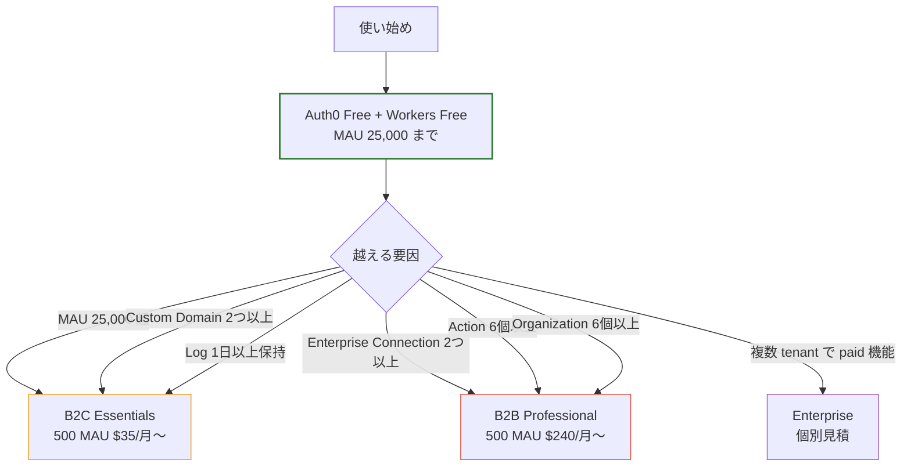
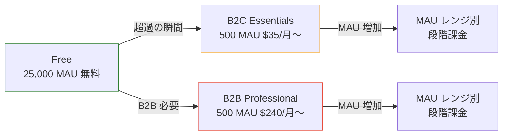
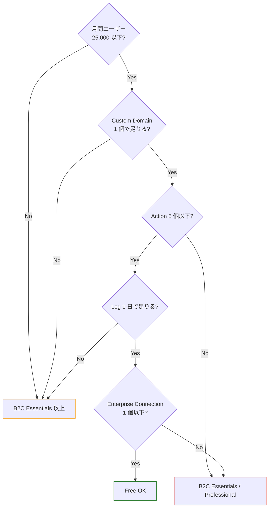

# 07. コスト・制限と有料への崖

> 「いつ無料枠で詰むか」「次に何を払うのか」を把握する。規模見積もりの判断材料。

## 30 秒サマリ

- **Auth0 Free**: MAU 25,000、Application 10、API 10、Action 5、Custom Domain 1（クレカ要）
- **MAU はテナント別にカウントされ、サブスクリプション全体で合算**される → dev/stg/prod 分離はコスト不利
- **Rules / Hooks は 2026-11-18 EOL** → Actions に移行必須
- **Free → 有料の崖が大きい**: 26,000 MAU で B2C Essentials 最小プランは月 $35〜 / Professional は $240〜
- **Cloudflare Workers Free**: 100,000 リクエスト/日、CPU 10ms。JWKS フェッチ + JWT 検証は十分収まる

## 全体像



## 詳細

### Auth0 Free 枠の制限（2026 年時点）

| 項目                                      | Free 枠                                            | 出典                                                                                                                 |
| ----------------------------------------- | -------------------------------------------------- | -------------------------------------------------------------------------------------------------------------------- |
| **MAU**                                   | 25,000                                             | [pricing](https://auth0.com/pricing)                                                                                 |
| Application / Tenant                      | 10                                                 | [entity-limit-policy](https://auth0.com/docs/troubleshoot/customer-support/operational-policies/entity-limit-policy) |
| API (Resource Server) / Tenant            | 10                                                 | 同上                                                                                                                 |
| Connection / Tenant                       | 100                                                | 同上                                                                                                                 |
| **Social Connection / Tenant**            | **2**（pricing は "Unlimited" と矛盾。安全側で 2） | 同上                                                                                                                 |
| Enterprise Connection / Tenant            | 1                                                  | [pricing](https://auth0.com/pricing)                                                                                 |
| Rules / Tenant                            | 3（**2026-11-18 EOL**）                            | [entity-limit-policy](https://auth0.com/docs/troubleshoot/customer-support/operational-policies/entity-limit-policy) |
| Actions + Forms                           | 5                                                  | [pricing](https://auth0.com/pricing)                                                                                 |
| Organizations                             | 5                                                  | [pricing](https://auth0.com/pricing)                                                                                 |
| Custom Domain                             | 1（**クレカ認証必須**）                            | [pricing](https://auth0.com/pricing)                                                                                 |
| Admins（Teams 含む）                      | 3                                                  | [entity-limit-policy](https://auth0.com/docs/troubleshoot/customer-support/operational-policies/entity-limit-policy) |
| Client Grants                             | 100                                                | 同上                                                                                                                 |
| **M2M Token / 月**                        | 1,000                                              | [pricing](https://auth0.com/pricing)                                                                                 |
| Event Streams                             | 1                                                  | [pricing](https://auth0.com/pricing)                                                                                 |
| Token Vault                               | 2                                                  | [pricing](https://auth0.com/pricing)                                                                                 |
| **Log 保持期間**                          | 1 日                                               | [pricing](https://auth0.com/pricing)                                                                                 |
| **Production タグを付けられる Tenant 数** | サブスクリプションあたり 1                         | [tenant-settings](https://auth0.com/docs/get-started/tenant-settings)                                                |
| Tenant 数 / アカウント                    | 明示的な上限なし（公式コミュニティ回答）           | [community](https://community.auth0.com/t/any-limits-of-tenants-allow-for-free-plan/44766)                           |
| サポート                                  | コミュニティのみ                                   | [pricing](https://auth0.com/pricing)                                                                                 |
| MFA                                       | Basic（Pro MFA は Essentials 以上）                | [pricing](https://auth0.com/pricing)                                                                                 |

### Free 枠で「できないこと」

- Custom Domain 2 つ以上
- Production タグを 2 つ以上の Tenant に付与
- Enterprise Connection 2 つ以上（SAML / Azure AD / ADFS）
- 3 つ目以降の Social Connection（要検証）
- 5 つ以上の Organization
- 6 つ目以降の Action
- Log を 2 日以上保持 / Log Stream 機能
- Pro MFA / Enhanced Attack Protection / Audit Log Streaming / Dashboard 経由の高度な RBAC 操作（一部）
- メーカーサポート（Community のみ）
- Admin 4 名以上招待

### MAU の数え方（最重要）

```mermaid
graph LR
    U[同じユーザー<br/>jane@example.com]
    U -->|1 login| D1[dev Tenant<br/>+1 MAU]
    U -->|1 login| D2[stg Tenant<br/>+1 MAU]
    U -->|1 login| D3[prod Tenant<br/>+1 MAU]
    D1 --> Total[合計 3 MAU 消費]
    D2 --> Total
    D3 --> Total

    style Total stroke:#e74c3c,stroke-width:2px
```

**ルール**:
- MAU は **Tenant ごとに別カウント、サブスクリプション全体で合算**
- 同一ユーザーを 1 MAU に抑えたい場合は「**単一 Tenant 内で複数 Application を作る**」が正解
- 環境ごとに Tenant を分けると、テストユーザー含めて MAU を浪費する

### Free → 有料の崖



**重要な事実**:
- 25,000 MAU の次のプラン最小単位は **500 MAU $35/月〜**（B2C Essentials）または **500 MAU $240/月〜**（B2B Professional）
- 「26,000 MAU で月数十ドル」のような細かい中間プランは無い
- 需要が出た瞬間に商用契約の見積もりが必要

**他の注意事項**:
- B2C Professional の M2M Token 上限は月 **5,000**。Add-on で 7,500 = $30/月、50,000 = $200/月
- **paid 機能は契約 Tenant にのみ適用**、同じアカウント配下の dev / stg Tenant には引き継がれない
- 複数 Tenant に paid 機能をリンクできるのは **Enterprise プランのみ**

### Cloudflare Workers Free 枠

| 項目            | Free 枠            |
| --------------- | ------------------ |
| リクエスト      | 100,000 / 日       |
| CPU 時間        | 10 ms / リクエスト |
| Workers KV 読込 | 100,000 / 日       |
| Workers KV 書込 | 1,000 / 日         |
| Durable Objects | 有料プラン要       |

**JWT 検証コストの目安**:
- RS256 検証（SubtleCrypto）は 1ms 未満 → CPU 10ms に十分収まる
- JWKS フェッチは warm isolate で 0ms、初回のみ数十〜数百 ms
- 1 日 10 万リクエストでもほぼ無料運用可能

## 落とし穴

- **MAU の数え方を勘違い**: 環境分離して MAU を 3 倍消費する事故
- **`Production` タグ 1 個制限**: dev / stg / prod の 3 Tenant でも本番相当レートリミットは 1 つだけ
- **Custom Domain も Free だがクレカ必須**: 純粋な無料運用にはならない
- **Free → 有料の崖が大きい**: 規模見積もりで詰むことがある。早めに段階を確認する
- **paid 機能の Tenant 別適用**: dev に paid 機能を付けて開発したくても、prod 契約とは別契約になる
- **Rules / Hooks の EOL（2026-11-18）**: 既存運用がある場合は移行期限あり
- **M2M Token の月上限**: B2C Professional でも 5,000/月。バッチ処理で枯渇しやすい
- **Workers の CPU 10ms 制限**: JWT 検証は問題ないが、JWKS フェッチが遅延すると吸い込まれる可能性 → モジュールスコープでキャッシュ必須

## プラン選定の判断ツリー



## 参考リンク

- [Auth0 Pricing](https://auth0.com/pricing)
- [Auth0 Entity Limit Policy](https://auth0.com/docs/troubleshoot/customer-support/operational-policies/entity-limit-policy)
- [MAU 計算方法（公式 blog）](https://auth0.com/blog/auth0-monthly-active-user-mau-explained/)
- [Rules / Hooks EOL（2026-11-18）](https://auth0.com/blog/preparing-for-rules-and-hooks-end-of-life/)
- [Deprecations and Migrations](https://auth0.com/docs/troubleshoot/product-lifecycle/deprecations-and-migrations)
- [Tenants per Free account（コミュニティ公式回答）](https://community.auth0.com/t/any-limits-of-tenants-allow-for-free-plan/44766)
- [Tenants per subscription（コミュニティ公式回答）](https://community.auth0.com/t/how-many-tenants-may-i-have-in-my-subscription/106170)
- [Cloudflare Workers Pricing](https://developers.cloudflare.com/workers/platform/pricing/)
- [Cloudflare Workers Limits](https://developers.cloudflare.com/workers/platform/limits/)
