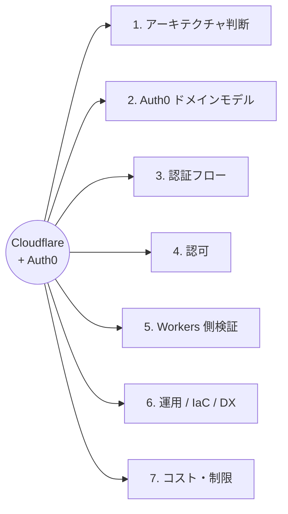
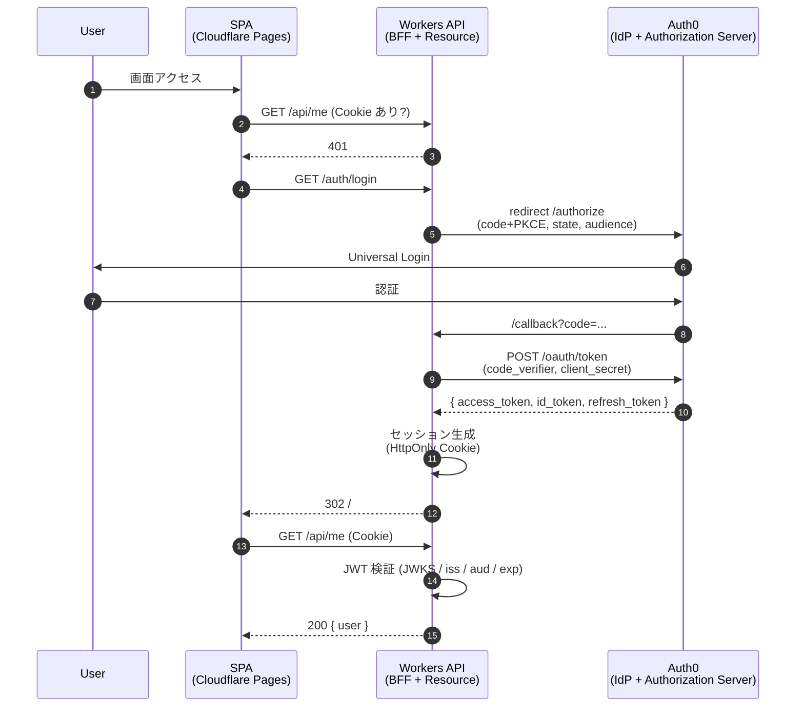

# Cloudflare Workers + Auth0 認証認可サンプル

> モダンかつ無料枠で完結する認証認可基盤のリファレンス。**Workers が Auth0 発行の JWT を検証する**構成を中心に扱う。

## 30 秒サマリ

- **構成の核**: ブラウザ SPA → Auth0 で認証 → Access Token (JWT) を取得 → Cloudflare Workers に Bearer 送付 → Workers が JWKS で署名検証
- **無料枠**: Auth0 Free (MAU 25,000) + Cloudflare Workers Free
- **IaC**: Auth0 リソースは `auth0/auth0` Terraform Provider で管理
- **モダン要件**: Authorization Code + PKCE / Refresh Token Rotation / RS256 / Custom Claim (Actions)
- **推奨スタック**: Hono + `jose` (Workers 側) / Auth0 SPA SDK (フロント側) / Terraform + Auth0 CLI (運用)

## マスター知識ツリー

「7 つの軸 × 各軸の主要トピック」で構成。まず全体像の図を見て、詳細はその下のテキスト階層を辿る。

### 高レベル全体像

### 詳細トピック（軸ごとに展開）

各ノードのリンクから該当ドキュメントに飛べる。

- **1. アーキテクチャ判断** → [04-auth-flow.md](./04-auth-flow.md)
  - (A) SPA 直接 + Workers が JWT 検証（シンプル・デモ向き）
  - (B) BFF パターン（本番推奨・IETF BCP 準拠）
- **2. Auth0 ドメインモデル** → [01-auth0-basics.md](./01-auth0-basics.md)
  - Tenant — 最上位の分離単位
  - Application — SPA / Native / M2M / Regular Web
  - API (Resource Server) — 保護対象 + Permissions
  - Connection — DB / Social / Enterprise
  - User / Role / Permission → [05-authorization.md](./05-authorization.md)
  - Actions（Rules / Hooks の後継）→ [05-authorization.md](./05-authorization.md)
- **3. 認証フロー** → [04-auth-flow.md](./04-auth-flow.md)
  - Authorization Code + PKCE
  - Refresh Token Rotation
  - Token 保存場所
    - HttpOnly Cookie（BFF 経由）
    - Memory + Rotation
- **4. 認可** → [05-authorization.md](./05-authorization.md)
  - Core RBAC
  - Custom Claim via Actions
  - `permissions` claim vs `scope`
- **5. Workers 側検証** → [03-cloudflare-workers-jwt.md](./03-cloudflare-workers-jwt.md)
  - jose ライブラリ
  - JWKS キャッシュ戦略
  - Hono ミドルウェア実装
- **6. 運用 / IaC / DX**
  - Terraform Provider `auth0/auth0` → [02-terraform.md](./02-terraform.md)
  - tfstate バックエンド（R2 / Local / HCP）→ [02-terraform.md](./02-terraform.md)
  - Auth0 CLI（動作確認 / トークン取得）→ [06-dev-experience.md](./06-dev-experience.md)
  - Deploy CLI（採用判断: Terraform で代替）→ [06-dev-experience.md](./06-dev-experience.md)
  - Secret 管理（`wrangler secret` / `.dev.vars`）→ [06-dev-experience.md](./06-dev-experience.md)
  - テスト戦略（Vitest + miniflare）→ [06-dev-experience.md](./06-dev-experience.md)
- **7. コスト・制限** → [07-cost-and-limits.md](./07-cost-and-limits.md)
  - Free 枠の壁
  - 有料への崖（25,000 MAU 超え）
  - MAU の数え方（テナント別合算）

## ドキュメント構成

| #  | ファイル                                                    | 内容                                           | こんな時に読む                |
| -- | ----------------------------------------------------------- | ---------------------------------------------- | ----------------------------- |
| -  | [README.md](./README.md)                                    | 全体マップ・知識ツリー                         | 最初に / 迷ったら戻る         |
| 01 | [auth0-basics.md](./01-auth0-basics.md)                     | Tenant / Application / API / Connection の基礎 | Auth0 の用語が分からない      |
| 02 | [terraform.md](./02-terraform.md)                           | Terraform Provider / 認証 / tfstate            | Auth0 リソースを IaC 化したい |
| 03 | [cloudflare-workers-jwt.md](./03-cloudflare-workers-jwt.md) | Workers で JWT を検証する具体実装              | 実装サンプルが欲しい          |
| 04 | [auth-flow.md](./04-auth-flow.md)                           | OAuth2/OIDC フロー選定 / BFF vs SPA 直接       | 構成を決める時                |
| 05 | [authorization.md](./05-authorization.md)                   | RBAC / Custom Claim / Workers 側の権限チェック | 認可ロジックを実装する時      |
| 06 | [dev-experience.md](./06-dev-experience.md)                 | CLI 使い分け / ローカル開発 / テスト / Secret  | 開発フロー全般                |
| 07 | [cost-and-limits.md](./07-cost-and-limits.md)               | 無料枠 / 有料への崖 / MAU の数え方             | 規模見積もり / プラン判断     |

## 全体アーキテクチャ（推奨構成）

## このリポジトリの前提

- 想定読者: 同等のシステム構成を組む技術者（自分含む）
- 採用判断: **(A) SPA 直接** をデモ用最小構成として、**(B) BFF** を本番推奨として両方解説する
- 検証範囲: ドキュメント。実装は別タスクで TDD で進める
- 情報源: Auth0 / Cloudflare の公式ドキュメント（2026 年時点）

## 用語クイックリファレンス

| 用語                   | 一行説明                                               | 詳細                                 |
| ---------------------- | ------------------------------------------------------ | ------------------------------------ |
| Tenant                 | Auth0 上のリソースの最上位分離単位                     | [01](./01-auth0-basics.md)           |
| Application            | Auth0 に登録するクライアントの種類（SPA / M2M 等）     | [01](./01-auth0-basics.md)           |
| API (Resource Server)  | 保護対象 API。Permission を定義する場所                | [01](./01-auth0-basics.md)           |
| Connection             | ユーザーソース（DB / Social / Enterprise）             | [01](./01-auth0-basics.md)           |
| Action                 | 認証フローに挟む Node.js 関数（Rules / Hooks の後継）  | [05](./05-authorization.md)          |
| PKCE                   | 認可コード横取り防御の仕組み                           | [04](./04-auth-flow.md)              |
| Refresh Token Rotation | Refresh Token を毎回新しいものに置換する Auth0 機能    | [04](./04-auth-flow.md)              |
| audience               | Access Token の対象 API を識別するパラメータ           | [04](./04-auth-flow.md)              |
| JWKS                   | JWT 署名検証用の公開鍵セット（Auth0 が公開）           | [03](./03-cloudflare-workers-jwt.md) |
| permissions claim      | Access Token に埋め込まれる権限配列（Auth0 独自）      | [05](./05-authorization.md)          |
| BFF                    | Backend for Frontend。トークンをサーバ側で保持する構成 | [04](./04-auth-flow.md)              |
